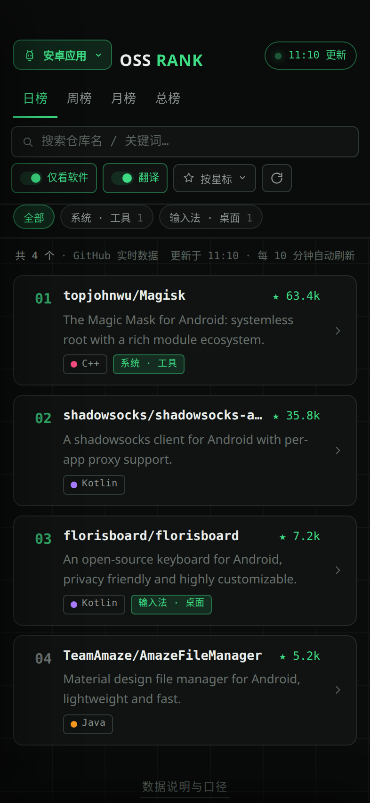
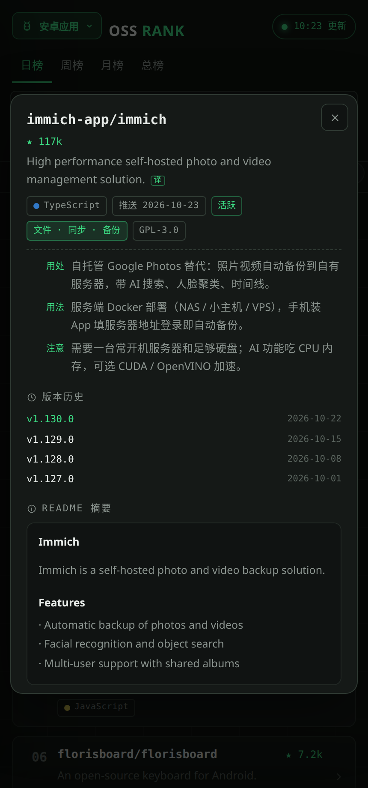

<div align="center">

# OSS Rank · 星跃榜

**GitHub 开源软件实时榜单 App** —— Android 原生壳 + 单文件 Web 应用，一套代码双端交付

[](https://github.com/lueyoyo1-afk/oss-rank/releases)


**在线网页版**：<https://mdkvbklgkmwtfscderrc.supabase.co/functions/v1/gh-oauth/app/>
**APK 直装**：<https://github.com/lueyoyo1-afk/oss-rank/releases/latest>

</div>

---

Android / Windows / iOS / macOS 四大平台开源应用榜单 × 日 / 周 / 月 / 总时间维度，外加 **Skill 分享榜**（AI 智能体技能仓库）与 **精选深评榜**（人工整理：用处 / 用法 / 注意事项），英文描述自动翻译成中文。

| 榜单 | 详情 |
|---|---|
|  |  |

## 下载安装

| 方式 | 说明 |
|---|---|
| **APK 直装（推荐）** | 到 [Releases](https://github.com/lueyoyo1-afk/oss-rank/releases/latest) 下载 `OSSRank-vX.Y.apk` 直接安装（Android 9.0+） |
| **在线网页版** | 浏览器打开上面链接即可用，无需安装 |
| **PWA 安装** | 网页版在浏览器菜单选「添加到主屏幕」，获得独立图标与离线外壳 |
| **应用内自更新** | 装好 APK 后，新版本会在应用内自动检测并提示，一键下载安装 |

## 功能特性

**榜单浏览**
- 五大来源：Android / Windows / iOS / macOS / Skill 分享榜 + 编辑精选 + 我的收藏 + 安装记录
- 日 / 周 / 月 / 总四档时间维度，按星标 / 最近推送 / 涨星速度三种排序
- 分类筛选条（带数量角标）、语言标签、分类标签、飙升榜、NEW 徽标、星标趋势百分比、迷你 sparkline
- 视图分享：来源 / 维度 / 排序 / 搜索词实时编码进 URL hash
- 详情深链：`#repo=owner/name` 直达任意仓库详情，详情页一键「分享链接」

**详情页**
- README 摘要、License、最近 Release 元信息、截图骨架屏 + 淡入
- 多 APK / ABI 架构选择（arm64-v8a / armeabi-v7a / x86_64，自动匹配机型）

**下载与安装管理**
- 断点续传下载、通知栏进度 + 下载完成后通知栏直接安装
- 安装失败中文诊断（签名冲突 / 版本降级 / 存储不足等）与处理建议
- 包检测档案：版本号 / 签名指纹 / 首次安装 / 系统要求 / 权限数
- APK 空间统计与清理、批量检查已装应用的新版本

**其他**
- 收藏夹分组、安装记录页、榜单/数据导出 Markdown
- 深色 / 浅色 / 跟随系统主题；长按卡片快捷菜单；列表滚动记忆
- 深度链接：系统内打开 github.com 仓库链接直达应用详情
- 全内联 SVG 图标（无 emoji）；PWA 离线外壳（sw.js）

## 构建 APK

```bash
cd android
./gradlew assembleRelease        # 产物：app/build/outputs/apk/release/app-release.apk
```

- 需要 JDK 17 + Android SDK 34
- 签名密钥（`android/keystore/`）**不入库**：自行生成 `ossrank.jks` 并按 `app/build.gradle` 中 `signingConfigs.release` 的路径放置，或去掉签名配置用 debug 包
- 自更新通道依赖 `index.html` 内的 Supabase `version.json` 地址；自建通道请同步修改 `UPDATE_URL` / `CANON_URL` 两个常量

## 自更新通道安全模型

存储桶对匿名角色**只读**（公开 key 本就公开，可放心入库）；写入权限仅在发版时临时开启、传完立即撤销，完整流程见 [DEPLOY.md](DEPLOY.md)。

## License

[MIT](LICENSE)
